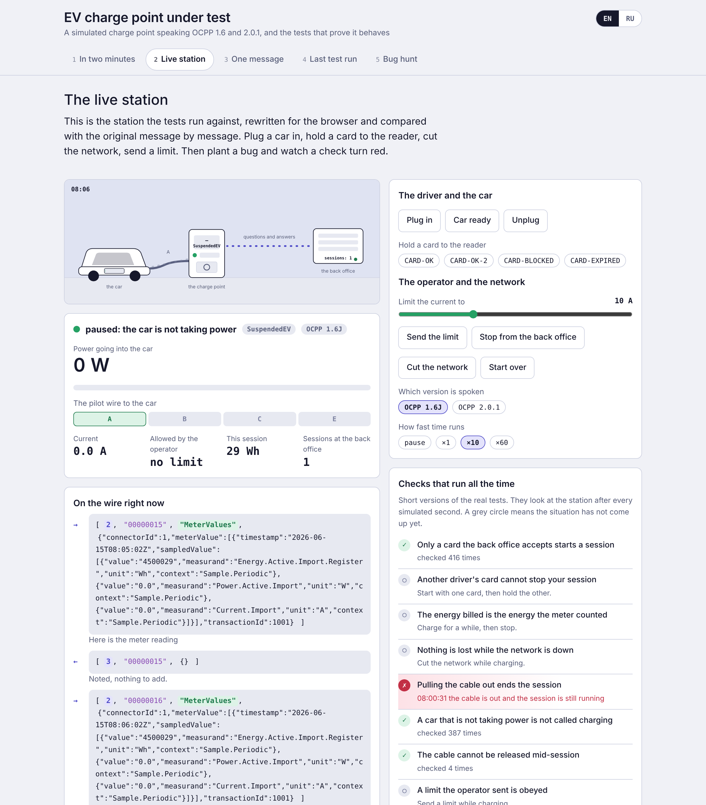

# ev-charging-testing

[](https://github.com/NailKarimov/ev-charging-testing/actions/workflows/tests.yml)
[](https://nailkarimov.github.io/ev-charging-testing/index.html)
[](https://github.com/NailKarimov/ev-charging-testing/releases)
[](https://codespaces.new/NailKarimov/ev-charging-testing?quickstart=1)

### ▶ Open online

| Page                                                                                                            | What it is                                                              |
| --------------------------------------------------------------------------------------------------------------- | ------------------------------------------------------------------------- |
| **[The project in two minutes](https://nailkarimov.github.io/ev-charging-testing/ev-charging.html#tour)**       | for a reader with no technical background: pictures and plain sentences |
| **[Live charge point](https://nailkarimov.github.io/ev-charging-testing/ev-charging.html#live)**                | plug a car in, hold a card to the reader, cut the network, plant a bug  |
| [On the wire](https://nailkarimov.github.io/ev-charging-testing/ev-charging.html#wire)                          | one OCPP message taken apart field by field, in both versions           |
| [Last test run, replayed](https://nailkarimov.github.io/ev-charging-testing/ev-charging.html#replay)            | every test as one sentence, with the real messages it exchanged         |
| [Bug hunt](https://nailkarimov.github.io/ev-charging-testing/ev-charging.html#bugs)                             | 41 planted bugs and the tests that caught each                          |
| [Allure test report](https://nailkarimov.github.io/ev-charging-testing/index.html)                              | latest CI run, four passes of the suite                                 |

Click these links: opening an `.html` file in the file list shows its source code, GitHub does not run it.

[](https://nailkarimov.github.io/ev-charging-testing/ev-charging.html#live)

A simulated **EV charge point** that speaks **OCPP 1.6J** and **OCPP 2.0.1** to a back office over WebSocket, and
the **Python + pytest** suite that proves it behaves: the envelope every message travels in, a session from cable
to invoice, the network going down mid-charge, limits from the operator, and orders arriving at the worst moment.

The oracle is not this repository. Every message is checked against the **JSON schemas published with the
standard**, and the counterparty in the interoperability suite is the **reference `ocpp` library** written by
somebody else.

The project is built to be shown to people who do not read code. Every test is one plain sentence, and one page
turns the run into pictures: [open it](https://nailkarimov.github.io/ev-charging-testing/ev-charging.html).

## At a glance

| Row                | Content                                                                                                                                                                 |
| -------------------- | ------------------------------------------------------------------------------------------------------------------------------------------------------------------------- |
| System under test  | Own simulator of a two-connector AC charge point (`src/evse_lab`): pilot wire, meter, cards, smart charging, offline queue, and both OCPP dialects over one model       |
| Language and tools | Python 3.12; pytest, Hypothesis, websockets, jsonschema, the `ocpp` reference library, Allure, ruff, mypy; Playwright and Node.js for the visual page                   |
| Types of testing   | Protocol conformance, schema validation against the published standard, interoperability, functional behaviour, negative and boundary, property-based fuzzing, robustness |
| Tests              | 269 across four passes of the suite (148 on OCPP 1.6 and 102 on 2.0.1 in memory, 10 and 9 over a real WebSocket) + 21 browser tests of the visual page                  |
| Test quality       | 41/41 planted bugs caught (`scripts/mutants.py`); the JavaScript twin of the station gives 2164 identical messages in 22 conversations                                  |
| Reports            | [Allure](https://nailkarimov.github.io/ev-charging-testing/index.html) · [visual page](https://nailkarimov.github.io/ev-charging-testing/ev-charging.html) · [mutation table](https://nailkarimov.github.io/ev-charging-testing/mutants/result.md) |

## What is tested

| Suite                    | Tool                          | What it proves                                                                                                       |
| -------------------------- | ------------------------------- | ---------------------------------------------------------------------------------------------------------------------- |
| `test_envelope`          | own codec, raw text           | The OCPP-J envelope: a call, an answer, a refusal; a damaged message is refused with the code the standard names     |
| `test_schemas`           | jsonschema, official schemas  | 103 messages of the two versions: a missing required field, an unknown field and a value outside the list are refused |
| `test_session`           | simulated clock               | Cable in, card accepted, charging, card again, cable out — reported step by step, billed for the energy metered     |
| `test_authorization`     | simulated back office         | Accepted, blocked, expired and unknown cards; another card cannot stop somebody else's session                       |
| `test_offline`           | link that can be cut          | Charging carries on, nothing is sent, everything owed arrives in order, and a session is billed exactly once         |
| `test_smart_charging`    | charging profiles             | Limits in amps, stack levels, validity windows, the 6 A floor below which the station pauses instead of trickling    |
| `test_remote_commands`   | own client                    | Start, stop, restart, change the call-in interval, take a connector out of service, release a cable                  |
| `test_connector_status`  | pilot wire A/B/C/E            | What the car asks for and the one word the station reports, in both versions' vocabularies                           |
| `test_robustness`        | Hypothesis                    | Random text, oversized and deeply nested payloads, answers to nothing: the station answers the next real order       |
| `test_websocket`         | real sockets                  | The subprotocol handshake, a message larger than one frame, a connection cut mid-session, a write into a dead link   |
| `test_interop`           | the `ocpp` library            | Somebody else's charge point is understood by this back office, and somebody else's back office by this station      |
| `test_pages`, `twin.test.mjs` | Playwright, Node.js      | The visual page works in a browser; its JavaScript twin answers message for message like the Python station          |

## Findings

No defects are open: the system under test is the project's own simulator, and it is corrected when a test finds a
fault. Five findings made on the way, including two the standard itself causes, are in
[`docs/test-report.md`](docs/test-report.md), section 3. Bug reports for third-party systems of the portfolio are on
the [QA defects board](https://github.com/users/NailKarimov/projects/2).

## Running it

No local setup: the **Open in GitHub Codespaces** badge starts a browser VS Code with Python, Node and Chromium
installed; then `pytest` works in the terminal.

Locally:

```bash
pip install -e ".[dev,pages]"
pytest                               # OCPP 1.6, in memory
OCPP=2.0.1 pytest                    # the same tests, OCPP 2.0.1
LINK=websocket pytest                # the transport, over a real WebSocket
python scripts/mutants.py            # plant 41 bugs, one at a time, and count the catches
python scripts/build_pages.py        # rebuild docs/ev-charging.html from the last run
```

## Project structure

```text
src/evse_lab/       the OCPP-J envelope, the official schemas, the station model, both dialects, the link and the back office
tests/              one file per suite; conftest.py picks the version and the link and records every message
tests/support/      the rig that wires a station to a back office, and the evidence recorder
scripts/            mutants.py (mutation check), build_pages.py (visual page, twin vectors)
site/               source of the visual page: five views, styles, the JavaScript twin, Russian texts
docs/               the built page, test plan, test report, guide, screenshots
evidence/           mutants.json; run-<version>-<link>.json is written by every test run
```

## Design decisions

- **The standard is the oracle, not this code.** `src/evse_lab/schemas.py` reads the JSON schemas shipped inside
  the `ocpp` package — 78 files for 1.6 and 128 for 2.0.1 — and every message sent or received is validated against
  them. A mistake shared by the station and its own client is still caught by the schema.
- **Somebody else sits at the other end.** `test_interop` puts the reference `ocpp` library on one side of a real
  WebSocket and this project on the other, in both directions.
- **One model, two dialects.** The station knows about cables, cards, meters and limits; `v16.py` and `v201.py`
  turn the same event into the messages of their version. That is what makes the two versions comparable, and it
  is where the differences between them become visible instead of hidden.
- **Time moves only on command.** There is no real clock in the tests: a test lets minutes pass. A whole session
  runs in milliseconds and every run sees the same session.
- **Every test is a sentence.** A test without a one-sentence docstring fails collection. The sentence is the
  title in Allure and on the visual page, in English and in Russian.
- **The page shows the real run.** Tests record every message; `build_pages.py` puts them into the page. The live
  station in the page is a JavaScript twin, checked against 2164 messages recorded from the Python station.

## CI

`.github/workflows/tests.yml` runs on push, pull request, nightly and on demand: lint and type check, the suite
four times (two versions × memory and WebSocket), the build of the visual page from that run, the twin check, the
browser tests. The Allure report with history, the visual page and the mutation table go to GitHub Pages. The
mutation job runs on demand (a checkbox in "Run workflow").

Releases: committing `.github/releases/<tag>.md` runs the Release workflow, which creates the tag and the GitHub
release with that file as its notes.

## Documentation

| Document                                     | What it is                                                                      |
| ---------------------------------------------- | --------------------------------------------------------------------------------- |
| [`docs/test-plan.md`](docs/test-plan.md)     | test plan (ISO/IEC/IEEE 29119-3)                                                |
| [`docs/test-report.md`](docs/test-report.md) | test summary report: latest results, findings, deviations                       |
| [`docs/ev-charging.md`](docs/ev-charging.md) | guide: OCPP, the two versions, the station, the schemas as oracle, the page      |
| [`docs/ev-charging.html`](https://nailkarimov.github.io/ev-charging-testing/ev-charging.html) | the same as an interactive page with five views (EN/RU) |
| [`mutants-result.md`](mutants-result.md)     | the mutation table of the latest full run                                       |

## Part of a portfolio

One of the test automation projects by [Nail Karimov](https://github.com/NailKarimov):
[all projects](https://github.com/NailKarimov) ·
[testing map](https://nailkarimov.github.io/api-test-automation/testing-map.html) ·
[toolbox](https://nailkarimov.github.io/api-test-automation/toolbox.html).
