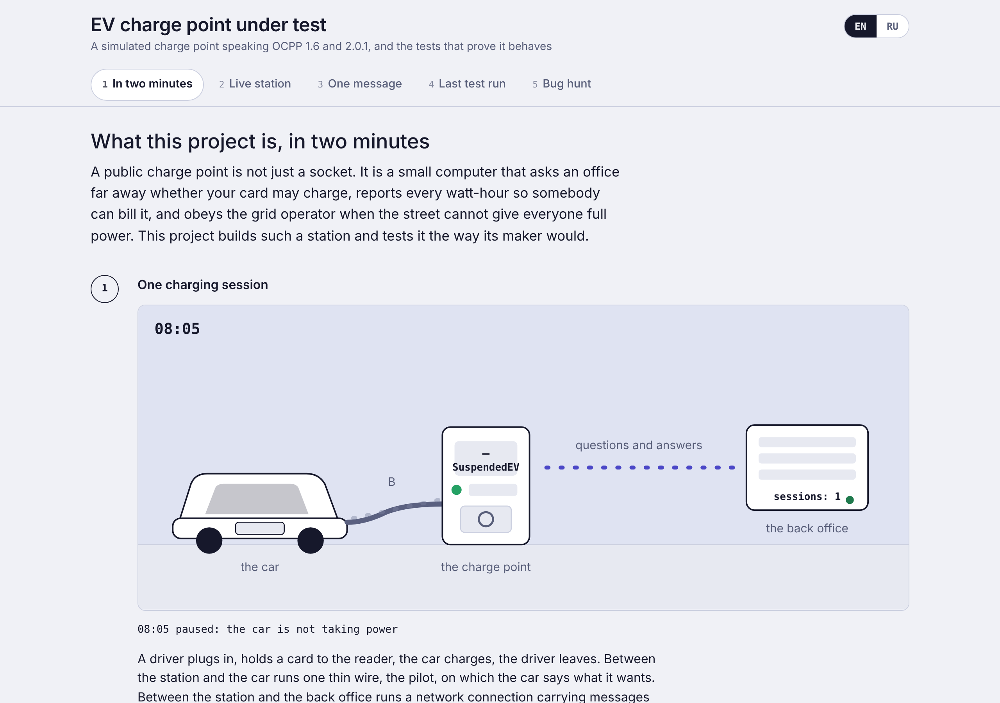
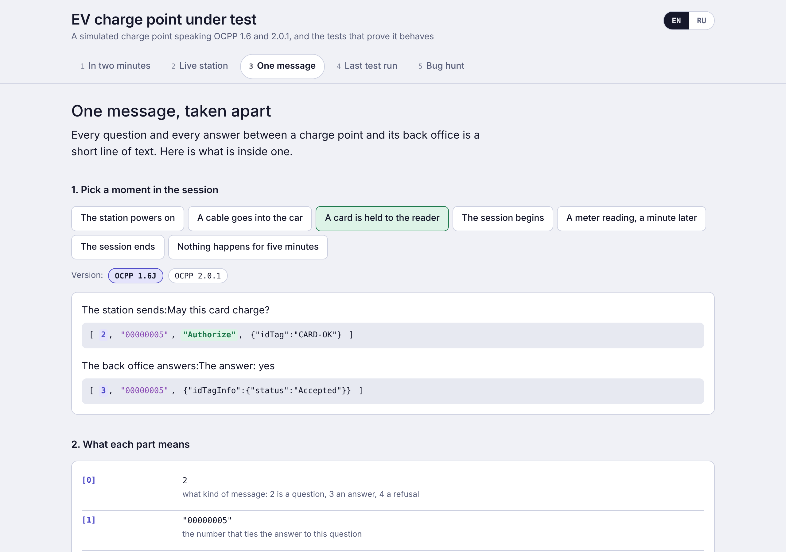
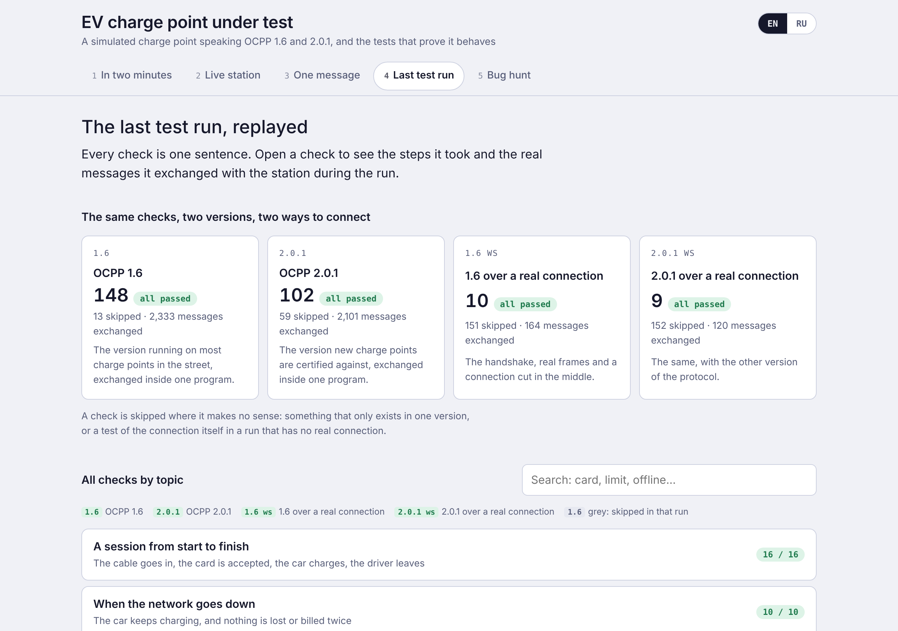
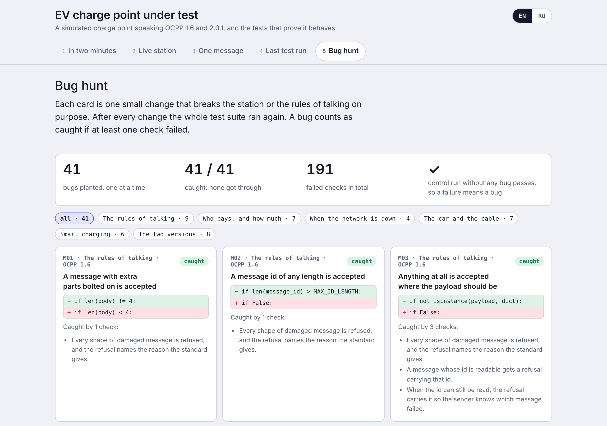

# A guide to this project

What OCPP is, what the simulated charge point does, how the standard itself is used as the judge, and what the
five views of the visual page show. Written for a reader who has never worked with charging stations.

The same material, with pictures and a station you can operate yourself, is at
[ev-charging.html](https://nailkarimov.github.io/ev-charging-testing/ev-charging.html).

## 1. What happens when a car is plugged in

A public charge point is two conversations at once.

**Downwards, to the car**, over a wire called **Control Pilot** (IEC 61851-1). It is not a data link. It is a
square wave whose **duty cycle says how many amps the car may take**, and whose voltage says what state things
are in: **A** no car, **B** car connected but not ready, **C** car ready and charging, **E** a fault. The car
never asks for a number — it reads the offer off the wire and takes up to that. Below **6 A** the pilot cannot
express an offer at all, which is why a station told to go lower must pause instead of trickling.

**Upwards, to the back office**, over **OCPP** — the Open Charge Point Protocol — on a WebSocket to the operator
who owns the station. That is where authorisation, billing, limits and remote commands live, and that is what
this project tests.

The whole of a normal session, in order:

1. The station powers on and introduces itself (`BootNotification`). The back office accepts it and says how
   often to call in.
2. A cable goes into the car. The pilot moves A → B. The station reports the connector as `Preparing`.
3. A card is held to the reader. The station asks the back office whether this card may charge (`Authorize`).
4. The back office says yes. The station opens a transaction, the pilot moves to C, current flows, the connector
   is reported `Charging`.
5. Once a minute the meter reading goes up to the back office (`MeterValues`).
6. The driver holds the same card again. The transaction closes with the energy counted, and the invoice is
   built from that number.
7. The cable comes out, the pilot falls back to A, the connector is `Available` again.

Everything this project tests is a way for one of those seven steps to go wrong.

## 2. The two versions

OCPP 1.6J is what most charge points in the street speak. OCPP 2.0.1 is what new ones are certified against.
They are not dialects of one grammar; the session is modelled differently.

| | OCPP 1.6J | OCPP 2.0.1 |
| --- | --- | --- |
| Messages in the standard | 39 | 64 |
| A session is | three separate messages: `StartTransaction`, `MeterValues`, `StopTransaction` | one message, `TransactionEvent`, with `Started`, `Updated`, `Ended` |
| Who names the session | the **back office**, in its answer to `StartTransaction` — a number | the **station**, itself — a string |
| Gaps are visible by | nothing in the protocol | `seqNo`, which counts every event of the session in order |
| An unknown card is | `Invalid` | `Unknown` |
| A meter reading is | `{"value": "3680.0", "unit": "Wh"}` — the number as text | `{"value": 3680.0, "unitOfMeasure": {"unit": "Wh"}}` — the number as a number |
| Connector statuses | `Available`, `Preparing`, `Charging`, `SuspendedEV`, `SuspendedEVSE`, `Finishing`, … | several of those collapsed into `Occupied` |
| Offline events | not marked | marked `offline: true` |

Two of those rows caused real defects in this project; both are in
[the test report](test-report.md), findings EVC-1 and EVC-4.

The difference that matters most is the third row. In 1.6 the station **cannot know the name of a session until
the back office answers**. So a station that loses the network mid-session has to hold its messages and fill in
the number later. In 2.0.1 the station names the session itself and can therefore run a whole session with
nobody listening. That is finding EVC-5, and it is why this project builds every queued message at the moment it
is sent rather than in advance.

## 3. The envelope

Every OCPP-J message is a JSON array, and there are only three kinds.

```text
[2, "19223201", "Authorize", {"idTag": "CARD-OK"}]            a call: a question
[3, "19223201", {"idTagInfo": {"status": "Accepted"}}]        a result: the answer to that question
[4, "19223201", "NotSupported", "Unknown action", {}]         an error: a refusal, with a reason
```

The number at the front says which kind. The string after it is the **message id**: an answer carries the id of
the question it answers, and that is the only thing tying the two together, because several questions may be in
flight. The error codes are fixed by the standard — `FormationViolation` for a message that is not shaped like a
message at all, `ProtocolError`, `PropertyConstraintViolation` for a value outside what is allowed,
`TypeConstraintViolation`, `NotImplemented` for an action in the standard that this station does not offer,
`NotSupported` for an action that is not in the standard at all.

One rule decides whether a refusal is even possible: **if the message id cannot be read, there is nothing to
answer**. A station that invents an id to refuse with would be answering a question nobody asked. In this
project `rpc.py` checks, in order: is it JSON, is it an array, is the first element a known kind, is there a
usable id, and only then the shape of that kind. The first check that fails decides the error code — and
`test_malformed_messages_are_refused_with_the_right_code` pins every one of those outcomes.

## 4. The station

`src/evse_lab/station.py` is a two-connector AC charge point and **knows nothing about OCPP**. It models the
pilot wire, a meter in watt-hours that only grows, cards, transactions, charging profiles and an offline queue.
It reports what happens as `Event` objects and takes orders as `Command` calls.

`v16.py` and `v201.py` turn the same event into the messages of their version. That is why one station can speak
both, and why a behaviour test — "pulling the cable out ends the session and says why" — is written once and run
twice.

Some details that matter to the tests:

- **The meter does not start at zero.** It starts at 4 500 000 Wh, because a station in service has been running
  for years. A session must be billed for the *difference*, and planted bug M14 — starting from zero — would bill
  every driver for the whole lifetime of the station.
- **Current offered is not current taken.** The station offers amps through the pilot; the car takes up to that.
  The meter must count what the car took. Planted bug M15 counts the offer instead, which over-bills a car that
  is nearly full.
- **Time moves only on command.** There is no real clock. A test lets ten minutes pass, and every run sees the
  same session.
- **Offline, nothing is invented and nothing is dropped.** Charging continues, the queue grows in order, and on
  reconnection the oldest goes first.

## 5. The standard as the judge

The weakness of testing your own simulator is that a misunderstanding shared by the code and its tests passes
both. This project handles that in two ways, neither of which is written by its author.

**The schemas.** The `ocpp` package ships the JSON schema files published with the standard — 78 for 1.6, 128
for 2.0.1. `schemas.py` reads them from that package, not from this repository, and `node.py` validates every
message in both directions. A message with a field the standard does not define, or a value outside the list it
allows, never reaches the station. `test_schemas` then goes through all 103 message types and checks that
leaving out a required field is refused.

The two versions even name their schema files differently — 1.6 has `Authorize.json` and
`AuthorizeResponse.json`, 2.0.1 has `AuthorizeRequest.json` and `AuthorizeResponse.json` — and `schema_name()`
is the one place that knows it.

**The reference library.** `test_interop` puts the `ocpp` library, written by The Mobility House, at one end of
a real WebSocket and this project at the other, in both directions: their charge point talking to this back
office, and this station talking to their back office. If the station's idea of a message were wrong in a way
the schema allows, somebody else's code would still choke on it.

## 6. How good are the tests?

A green suite says nothing about whether the tests would notice a real defect. `scripts/mutants.py` answers that
directly: it plants **41 bugs**, one at a time, in the simulator's source, runs the suite, and records which
tests went red. A bug nothing catches is a hole in the suite.

The bugs are the realistic ones — any card accepted, every session billed as zero, the offline queue replayed
backwards, a limit read upside down, a station offering a car less than 6 A. The current result is **41 of 41
caught**, with a control run that plants nothing and passes. The table, with the tests that caught each bug, is
[`mutants-result.md`](../mutants-result.md).

The first run caught 37. The four survivors were not defects in the simulator — they were gaps in the suite, and
four tests were written to close them. That is what the exercise is for.

## 7. The visual page

`docs/ev-charging.html` is one self-contained file with five views, in English and Russian.

| View | What you can do |
| --- | --- |
| **The project in two minutes** | watch a session play itself, with one real question and answer taken apart |
| **Live charge point** | plug a car in, hold a card to the reader, cut the network, send a limit, and **plant one of the 41 bugs** and watch the matching check turn red |
| **On the wire** | pick a moment of the session and see the message field by field, with the same moment in the other version beside it |
| **Last test run** | every test as one sentence; open one and see the steps and the real messages it exchanged |
| **Bug hunt** | all 41 planted bugs, the line each one changed, and the tests that caught it |

[](https://nailkarimov.github.io/ev-charging-testing/ev-charging.html#tour)

[](https://nailkarimov.github.io/ev-charging-testing/ev-charging.html#wire)

[](https://nailkarimov.github.io/ev-charging-testing/ev-charging.html#replay)

[](https://nailkarimov.github.io/ev-charging-testing/ev-charging.html#bugs)

Two things keep the page honest. The run view is built by `build_pages.py` from the evidence files the tests
write, so it cannot show a test that did not run. And the live station is a **JavaScript twin** of the Python
one: `site/test/twin.test.mjs` plays 22 scripted conversations through both and compares every message —
currently 2164 of them, all identical. If the twin drifted, the page would be a cartoon rather than a model, and
CI fails before it ships.

## 8. Where to look in the code

```text
src/evse_lab/rpc.py        the OCPP-J envelope: what is a call, an answer, a refusal, and what is damaged
src/evse_lab/schemas.py    the official schemas, read out of the ocpp package
src/evse_lab/station.py    the charge point: pilot, meter, cards, profiles, offline queue
src/evse_lab/v16.py        events and orders as OCPP 1.6 messages
src/evse_lab/v201.py       the same events and orders as OCPP 2.0.1 messages
src/evse_lab/node.py       an endpoint: validate, send one call at a time, answer or refuse
src/evse_lab/link.py       in memory, or a real WebSocket server and client
src/evse_lab/csms.py       a minimal back office: cards, transaction numbers, what it was told
```
